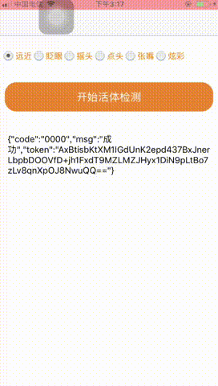
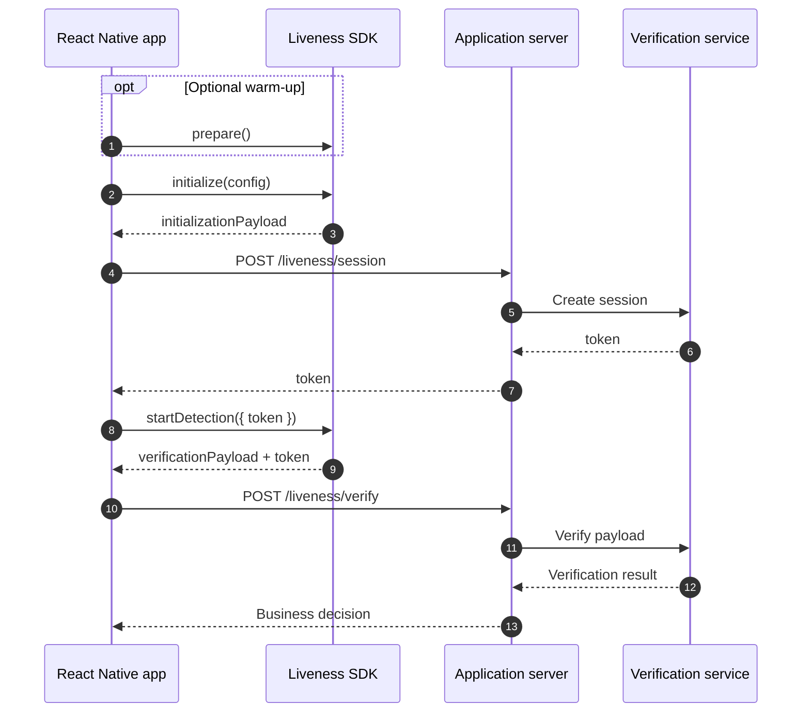
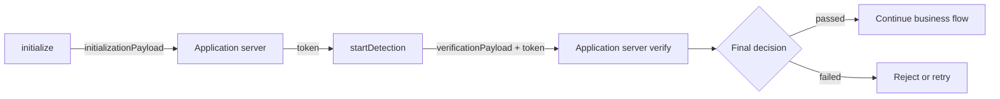
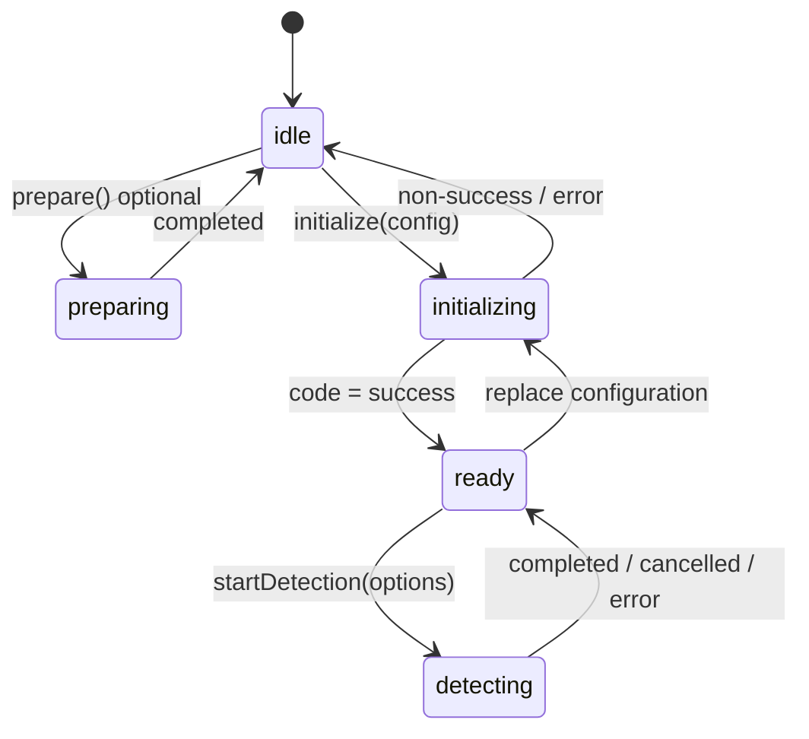

# React Native Liveness SDK

A proprietary React Native SDK for facial liveness detection on Android and iOS. It provides a typed JavaScript API while the bundled native SDK presents the detection screen.

> A `success` result from `initialize()` or `startDetection()` only means that the local SDK step completed successfully. The authoritative liveness decision must come from server-side verification.

## Demo



| Resource          | Link                                                                    |
| ----------------- | ----------------------------------------------------------------------- |
| Online demo       | [Open the browser demo](https://dev.esandcloud.com/h5demo/esand/living) |
| React Native demo | [`example/`](./example)                                                 |

The demo media comes from the reference project. The detection UI language can be configured through `LivenessConfig.language`.

## Responsibilities

| Capability                               | SDK | App | Application server |
| ---------------------------------------- | :-: | :-: | :----------------: |
| Validate options and call native code    | Yes |     |                    |
| Present the native detection screen      | Yes |     |                    |
| Choose when to request camera permission |     | Yes |                    |
| Render business UI and navigation        |     | Yes |                    |
| Create a short-lived detection token     |     |     |        Yes         |
| Store gateway credentials                |     |     |        Yes         |
| Return the final verification decision   |     |     |        Yes         |



## Compatibility

| Requirement               | Android                       | iOS                                    |
| ------------------------- | ----------------------------- | -------------------------------------- |
| React Native architecture | New Architecture              | New Architecture                       |
| Minimum OS                | API 23                        | Native SDK: iOS 9.0; app follows React Native requirements |
| Native architectures      | `armeabi-v7a`, `arm64-v8a`    | arm64 physical device                  |
| Cameras                   | Front and rear                | Front only                             |
| Emulator or simulator     | Not recommended for detection | Not supported by the bundled framework |

Web, Expo Go, HarmonyOS, macOS, and Windows are not supported.

## Android Integration

### 1. Install the package

```sh
npm install @esand/react-native-liveness
```

The package supports React Native autolinking. Do not add the native package manually unless autolinking is disabled in the host application.

### 2. Enable the New Architecture and supported ABIs

In `android/gradle.properties`:

```properties
newArchEnabled=true
reactNativeArchitectures=armeabi-v7a,arm64-v8a
```

The bundled Android library contains native binaries only for `armeabi-v7a` and `arm64-v8a`. Build and test on a physical device with one of these ABIs.

The host application's `minSdkVersion` must be at least 23. The library is compiled with Android API 36 and Java 17.

### 3. Configure permissions

The library manifest contributes the following entries automatically:

```xml
<uses-permission android:name="android.permission.CAMERA" />
<uses-feature android:name="android.hardware.camera" android:required="true" />
```

Add `INTERNET` to the application manifest when the app calls its backend:

```xml
<uses-permission android:name="android.permission.INTERNET" />
```

Request camera permission before starting detection. The SDK reports a native `permission_denied` result when access is unavailable, but the host application owns the permission prompt and settings flow.

```ts
import { PermissionsAndroid } from 'react-native';

export async function ensureAndroidCameraPermission(): Promise<boolean> {
  const result = await PermissionsAndroid.request(
    PermissionsAndroid.PERMISSIONS.CAMERA
  );
  return result === PermissionsAndroid.RESULTS.GRANTED;
}
```

### 4. Rebuild the application

Native dependencies require a full rebuild after installation:

```sh
cd android
./gradlew clean
cd ..
npx react-native run-android
```

Metro reload alone does not install or update the native module.

### 5. Verify the Android integration

```ts
const capabilities = await Liveness.getCapabilities();

if (capabilities.platform !== 'android') {
  throw new Error('Unexpected native platform.');
}
```

Expected Android capabilities include both `front` and `rear` cameras.

### Android troubleshooting

| Symptom                         | Check                                                                           |
| ------------------------------- | ------------------------------------------------------------------------------- |
| Native module cannot be found   | Confirm `newArchEnabled=true`, run Gradle clean, and reinstall the app          |
| `dlopen` or missing `.so` error | Use an `armeabi-v7a` or `arm64-v8a` physical device and restrict the build ABIs |
| `permission_denied`             | Request `CAMERA` at runtime and handle permanent denial                         |
| `no_active_screen`              | Call detection only while a React Activity is in the foreground                 |
| Detection screen does not start | Confirm initialization returned `success` and the backend token is non-empty    |

## iOS Integration

### 1. Install the package

```sh
npm install @esand/react-native-liveness
```

### 2. Set the deployment target

The bundled native framework supports iOS 9.0 or later. The final application deployment target must satisfy all dependencies, including the React Native version used by the host app. In `ios/Podfile`, use React Native's supported minimum:

```ruby
platform :ios, min_ios_version_supported
prepare_react_native_project!
```

Also set the application target's deployment target to the same value or later in Xcode. For example, React Native 0.87.1 requires iOS 15.1 even though the bundled native SDK itself supports iOS 9.0.

### 3. Enable the New Architecture

The module is implemented as a TurboModule and requires React Native's New Architecture. Install Pods with the New Architecture enabled according to the host React Native version. For a standard React Native project:

```sh
cd ios
RCT_NEW_ARCH_ENABLED=1 bundle exec pod install
```

If the project does not use Bundler, run `RCT_NEW_ARCH_ENABLED=1 pod install` instead.

### 4. Add the camera usage description

Add the following entry to the application target's `Info.plist`:

```xml
<key>NSCameraUsageDescription</key>
<string>Camera access is required for facial liveness detection.</string>
```

The host application controls when the system permission prompt appears and how users are directed to Settings after a denial.

### 5. Use an arm64 physical device

The bundled iOS framework is device-only and cannot be linked into an iOS Simulator build. Select a physical arm64 iPhone or iPad as the Xcode run destination.

Only the front camera is supported on iOS. Passing `camera: 'rear'` rejects with `unsupported_option`.

### 6. Verify the iOS integration

```ts
const capabilities = await Liveness.getCapabilities();

if (capabilities.platform !== 'ios') {
  throw new Error('Unexpected native platform.');
}

console.log(capabilities.cameras); // ['front']
```

### iOS troubleshooting

| Symptom                                  | Check                                                                              |
| ---------------------------------------- | ---------------------------------------------------------------------------------- |
| Framework cannot be linked for Simulator | Select a physical arm64 device; Simulator is not supported                         |
| CocoaPods deployment target error        | Set the Podfile and application target to the minimum required by the host React Native version |
| Native module cannot be found            | Reinstall Pods with the New Architecture enabled, clean Derived Data, and rebuild  |
| Camera prompt is missing                 | Confirm `NSCameraUsageDescription` exists in the application target's `Info.plist` |
| `unsupported_option` for camera          | Use `front`; the bundled iOS SDK does not expose rear-camera startup               |
| `no_active_screen`                       | Start detection only while a foreground `UIViewController` is available            |

## Server Integration

The app should communicate only with its own trusted server. Gateway credentials must never be embedded in the app bundle, JavaScript, environment files shipped with the app, or SDK configuration.

Recommended minimum application-server contract:

| Endpoint                 | Request                                          | Response                                               | Purpose                                |
| ------------------------ | ------------------------------------------------ | ------------------------------------------------------ | -------------------------------------- |
| `POST /liveness/session` | `{ initializationPayload: string }`              | `{ token: string }`                                    | Create a short-lived detection session |
| `POST /liveness/verify`  | `{ token: string, verificationPayload: string }` | Application-defined, for example `{ passed: boolean }` | Return the authoritative result        |



## Complete JavaScript Flow

The same JavaScript flow is used on both platforms after completing the native integration steps above.

```ts
import {
  Liveness,
  LivenessAction,
  LivenessError,
  LivenessResultCode,
} from '@esand/react-native-liveness';

type Verification = {
  passed: boolean;
  reason?: string;
};

async function post<T>(path: string, body: unknown): Promise<T> {
  const response = await fetch(`https://api.example.com${path}`, {
    method: 'POST',
    headers: { 'Content-Type': 'application/json' },
    body: JSON.stringify(body),
  });

  if (!response.ok) {
    throw new Error(`Backend request failed with HTTP ${response.status}.`);
  }

  return response.json() as Promise<T>;
}

export async function runLiveness(): Promise<Verification> {
  try {
    const initialization = await Liveness.initialize({
      actions: [LivenessAction.Blink, LivenessAction.TurnHead],
      language: 'en',
      strictMode: true,
      recordVideo: false,
    });

    if (initialization.code !== LivenessResultCode.Success) {
      throw new Error(`Initialization failed: ${initialization.message}`);
    }

    const session = await post<{ token: string }>('/liveness/session', {
      initializationPayload: initialization.initializationPayload,
    });

    if (!session.token?.trim()) {
      throw new Error('The backend returned an empty detection token.');
    }

    const detection = await Liveness.startDetection({
      token: session.token,
      camera: 'front',
    });

    if (detection.code !== LivenessResultCode.Success) {
      throw new Error(`Detection did not complete: ${detection.message}`);
    }

    return post<Verification>('/liveness/verify', {
      token: detection.token,
      verificationPayload: detection.verificationPayload,
    });
  } catch (error) {
    if (error instanceof LivenessError) {
      console.error(error.code, error.message, error.details);
    }
    throw error;
  }
}
```

## Lifecycle and Concurrency



| Rule                | Behavior                                                            |
| ------------------- | ------------------------------------------------------------------- |
| Initialization      | `startDetection()` requires a successful `initialize()` call        |
| Single operation    | `prepare()`, `initialize()`, and `startDetection()` cannot overlap  |
| Reconfiguration     | A later successful `initialize()` replaces the active configuration |
| Foreground UI       | Detection requires a foreground Activity or `UIViewController`      |
| Native outcome      | Business outcomes resolve as typed results                          |
| Programming failure | Validation and bridge failures reject with `LivenessError`          |
| Final decision      | Only the server verification response is authoritative              |

## API Reference

### Methods

| Method                             | Returns                           | Description                                                    |
| ---------------------------------- | --------------------------------- | -------------------------------------------------------------- |
| `Liveness.prepare()`               | `Promise<void>`                   | Optionally warm up the native engine                           |
| `Liveness.initialize(config)`      | `Promise<InitializeResult>`       | Apply the detection policy and create initialization data      |
| `Liveness.startDetection(options)` | `Promise<DetectionResult>`        | Present native detection and return verification data          |
| `Liveness.getCapabilities()`       | `Promise<LivenessCapabilities>`   | Read platform actions, cameras, languages, and feature support |
| `Liveness.getSdkVersion()`         | `Promise<LivenessSdkVersion>`     | Read the bundled native SDK version                            |
| `Liveness.getDiagnosticInfo()`     | `Promise<LivenessDiagnosticInfo>` | Read the current and previous native call traces               |
| `Liveness.clearDiagnosticInfo()`   | `Promise<void>`                   | Delete stored call traces                                      |

### `LivenessConfig`

| Field              | Type                        | Required | Default | Constraint                                            |
| ------------------ | --------------------------- | :------: | ------- | ----------------------------------------------------- |
| `actions`          | `readonly LivenessAction[]` |   Yes    | -       | 1 to 4 unique actions; array order is execution order |
| `recordVideo`      | `boolean`                   |          | `false` | Save the detection video when available               |
| `strictMode`       | `boolean`                   |          | `false` | Enable strict native checks                           |
| `saveActionImages` | `boolean`                   |          | `false` | Save an image for each action when available          |
| `showNavigation`   | `boolean`                   |          | `false` | Show the native navigation bar                        |
| `language`         | `LivenessLanguage`          |          | `'en'`  | Native detection screen language                      |
| `appearance`       | `LivenessAppearance`        |          | `{}`    | Native detection screen styling                       |

Supported actions:

| Enum                        | Value         | Action                          |
| --------------------------- | ------------- | ------------------------------- |
| `LivenessAction.Distance`   | `distance`    | Move the face nearer or farther |
| `LivenessAction.Blink`      | `blink`       | Blink                           |
| `LivenessAction.TurnHead`   | `turn_head`   | Turn the head                   |
| `LivenessAction.Nod`        | `nod`         | Nod                             |
| `LivenessAction.OpenMouth`  | `open_mouth`  | Open the mouth                  |
| `LivenessAction.ColorFlash` | `color_flash` | Color-flash liveness            |

Supported languages: `zh-CN`, `zh-TW`, `en`, `ja`, `ko`, and `th`.

### `LivenessAppearance`

| Field                     | Type     | Constraint               |
| ------------------------- | -------- | ------------------------ |
| `backgroundColor`         | `string` | `#RRGGBB` or `#AARRGGBB` |
| `textColor`               | `string` | `#RRGGBB` or `#AARRGGBB` |
| `progressBackgroundColor` | `string` | `#RRGGBB` or `#AARRGGBB` |
| `progressStartColor`      | `string` | `#RRGGBB` or `#AARRGGBB` |
| `progressEndColor`        | `string` | `#RRGGBB` or `#AARRGGBB` |
| `progressWidth`           | `number` | 1 to 32                  |

### `StartDetectionOptions`

| Field    | Type                | Required | Default   | Description                                                   |
| -------- | ------------------- | :------: | --------- | ------------------------------------------------------------- |
| `token`  | `string`            |   Yes    | -         | Non-empty short-lived token created by the application server |
| `camera` | `'front' \| 'rear'` |          | `'front'` | iOS supports `front` only                                     |

### Results

Every native business result contains:

| Field          | Type                 | Description                                     |
| -------------- | -------------------- | ----------------------------------------------- |
| `code`         | `LivenessResultCode` | Cross-platform result code                      |
| `message`      | `string`             | Native result description                       |
| `nativeCode`   | `string`             | Original native SDK result code for diagnostics |
| `diagnosticId` | `string`             | Identifier for the native call trace            |

`InitializeResult` also contains:

| Field                   | Type     | Description                                        |
| ----------------------- | -------- | -------------------------------------------------- |
| `initializationPayload` | `string` | Send to the application server to create a session |

`DetectionResult` also contains:

| Field                 | Type      | Description                                                           |
| --------------------- | --------- | --------------------------------------------------------------------- |
| `verificationPayload` | `string`  | Send to the application server for final verification                 |
| `token`               | `string`  | Return this value together with `verificationPayload`                 |
| `videoPath`           | `string?` | Absolute local path when recording is enabled and a file is available |

### `LivenessResultCode`

| Value               | Meaning                                 | Recommended handling                          |
| ------------------- | --------------------------------------- | --------------------------------------------- |
| `success`           | The local SDK step succeeded            | Continue the flow; still verify on the server |
| `failed`            | The liveness step failed                | Allow a controlled retry                      |
| `invalid_argument`  | Native input was invalid                | Check configuration and the server token      |
| `exception`         | Native SDK exception                    | Record diagnostics and report or retry        |
| `timeout`           | Detection timed out                     | Ask the user to retry                         |
| `permission_denied` | Camera access was denied                | Run the platform permission flow              |
| `unsupported`       | The requested capability is unavailable | Read `getCapabilities()` and adjust options   |
| `cancelled`         | The user cancelled or exited            | Handle as a business cancellation             |
| `environment_error` | Device or detection environment error   | Use `message` to guide the user               |

## Errors

Validation and bridge failures reject with `LivenessError`:

| `error.code`                | Trigger                                                          |
| --------------------------- | ---------------------------------------------------------------- |
| `native_module_unavailable` | The native module is not linked or the platform is unavailable   |
| `invalid_configuration`     | Invalid action, color, width, token, or camera input             |
| `not_initialized`           | Detection started before a successful initialization             |
| `operation_in_progress`     | Another preparation, initialization, or detection call is active |
| `no_active_screen`          | No foreground native screen is available                         |
| `unsupported_option`        | The current platform does not support the selected option        |
| `native_bridge_error`       | Unclassified native bridge failure                               |

## React Hook

`useLivenessDetection()` manages SDK call state and the most recent `LivenessError`. It does not manage permissions, backend requests, UI, or navigation.

| Field            | Type                                                      | Description                       |
| ---------------- | --------------------------------------------------------- | --------------------------------- |
| `state`          | `idle \| preparing \| initializing \| ready \| detecting` | Current SDK call state            |
| `error`          | `LivenessError \| null`                                   | Most recent rejected call         |
| `prepare`        | function                                                  | Calls `Liveness.prepare()`        |
| `initialize`     | function                                                  | Calls `Liveness.initialize()`     |
| `startDetection` | function                                                  | Calls `Liveness.startDetection()` |
| `resetError`     | function                                                  | Clears the Hook error state       |

## Capabilities and Diagnostics

Use capabilities when platform behavior differs:

```ts
const capabilities = await Liveness.getCapabilities();
const camera = capabilities.cameras.includes('rear') ? 'rear' : 'front';
```

| Return type            | Fields                            | Description                                    |
| ---------------------- | --------------------------------- | ---------------------------------------------- |
| `LivenessCapabilities` | `platform`                        | `android` or `ios`                             |
|                        | `actions`, `cameras`, `languages` | Supported values on the active platform        |
|                        | `supportsVideoRecording`          | Video recording support                        |
|                        | `supportsActionImages`            | Per-action image support                       |
|                        | `supportsDiagnostics`             | Persistent diagnostics support                 |
| `LivenessSdkVersion`   | `platform`, `version`             | Active platform and bundled native SDK version |

Use `diagnosticId` to correlate a result with stored traces:

```ts
const diagnostics = await Liveness.getDiagnosticInfo();
await uploadDiagnostics(diagnostics);
await Liveness.clearDiagnosticInfo();
```

| Diagnostic field | Description                                                                             |
| ---------------- | --------------------------------------------------------------------------------------- |
| `current`        | Trace entries for the current native call                                               |
| `previous`       | Trace entries for the previous native call                                              |
| Trace entry      | Includes `callId`, `api`, `stage`, `timestamp`, `elapsedMs`, platform, and version data |

Diagnostics retain only the current and previous call traces. They do not contain tokens, initialization payloads, verification payloads, image data, video content, or gateway credentials.

## Running the Repository Demo

Install dependencies and start Metro from the repository root:

```sh
yarn install
yarn example start
```

Android, in another terminal:

```sh
yarn example android
```

iOS must run on a physical device. Open `example/ios/EsandLivenessExample.xcworkspace` in Xcode, select an arm64 device, and run the application.

The repository demo includes a test-only gateway adapter for integration testing. Replace it with the application's trusted server before production release.

## Production Checklist

| Check           | Requirement                                                                     |
| --------------- | ------------------------------------------------------------------------------- |
| Credentials     | No production AppCode, secret, or gateway credential is present in the app      |
| Server boundary | Session creation and final verification pass through the application server     |
| Decision        | Native `success` is never treated as the final liveness decision                |
| Permissions     | Denial, permanent denial, and return-from-Settings flows are handled            |
| Concurrency     | The start action cannot be triggered while another SDK call is active           |
| Platform        | iOS uses an arm64 physical device; camera choices come from capabilities        |
| Sensitive data  | Payloads, tokens, images, and video content are not written to logs             |
| Support data    | Logs retain `diagnosticId`, `nativeCode`, and the application-server request ID |

## Support

| Channel  | Contact                              |
| -------- | ------------------------------------ |
| Email    | `reid.li@foxmail.com`                |
| Phone    | `+86 136 9166 4797`                  |
| WeChat   | `esand_info`                         |
| QQ       | `3626921591`                         |
| Telegram | [@R90000000](https://t.me/R90000000) |


## Development

```sh
yarn typecheck
yarn lint
yarn test
yarn prepare
```

Internal design notes are available in [`doc/REACT_NATIVE_LIVENESS_DESIGN.md`](./doc/REACT_NATIVE_LIVENESS_DESIGN.md).

## License

This SDK is proprietary and is not distributed under an open-source license. No use, copying, modification, redistribution, sublicensing, or reverse engineering right is granted without a separate written agreement. See [`LICENSE`](./LICENSE).
